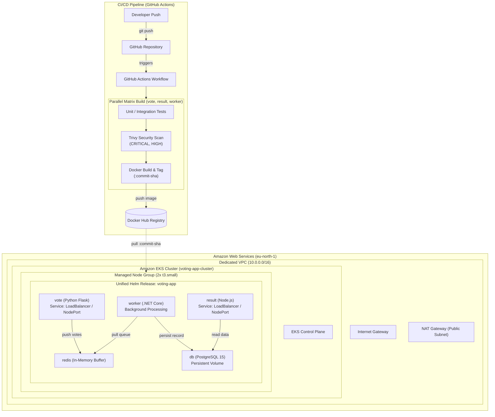

# Example Voting App — Cloud-Native Kubernetes & GitOps Orchestration (Capstone 1)

A multi-tier microservices application orchestrated on Amazon Elastic Kubernetes Service (EKS) using Terraform, a unified Helm chart, and automated GitHub Actions CI/CD with Trivy container vulnerability scanning.

---

## 1. System Architecture

The project implements an automated, secure deployment pipeline: code pushes to GitHub trigger matrix builds, test suites, and Trivy vulnerability scans in GitHub Actions. Container images tagged with immutable commit SHAs are pushed to Docker Hub and scheduled across Amazon EKS worker nodes within a dedicated AWS VPC.



---

## 2. Microservice Architecture

| Service | Technology Stack | Functionality | Networking / Port |
| :--- | :--- | :--- | :--- |
| **`vote`** | Python (Flask) | Front-end web UI allowing users to choose between two voting options. | Port 80 (HTTP) |
| **`redis`** | Redis | High-throughput in-memory queue buffering incoming votes. | Port 6379 (Internal) |
| **`worker`** | .NET Core | Background daemon polling Redis queue and writing records to PostgreSQL. | Headless (No ingress) |
| **`db`** | PostgreSQL 15 | Relational database storing votes with persistent volume claims. | Port 5432 (Internal) |
| **`result`** | Node.js / Express | Real-time web UI showing voting results calculated from PostgreSQL. | Port 80 / 4000 (HTTP) |

---

## 3. Repository Layout

```text
├── .github/
│   └── workflows/
│       ├── ci.yml                 # Matrix testing, Trivy scans, and Docker Hub builds
│       └── infra-destroy.yml      # On-demand workflow_dispatch teardown pipeline
├── charts/
│   └── voting-app/
│       ├── Chart.yaml             # Helm chart definition (v0.1.0)
│       ├── values.yaml            # Configurable service limits, replicas, and ports
│       └── templates/
│           ├── db-deployment.yaml
│           ├── db-service.yaml
│           ├── redis-deployment.yaml
│           ├── redis-service.yaml
│           ├── result-deployment.yaml
│           ├── result-service.yaml
│           ├── vote-deployment.yaml
│           ├── vote-service.yaml
│           └── worker-deployment.yaml
├── terraform/
│   ├── main.tf                    # VPC, Subnets, NAT, and EKS resource declarations
│   ├── variables.tf               # Region (eu-north-1), cluster name, and sizing parameters
│   └── outputs.tf                 # Cluster endpoint, kubeconfig context, and ARNs
├── vote/                          # Python Flask service source code & Dockerfile
├── result/                        # Node.js service source code & Dockerfile
└── worker/                        # .NET Core service source code & Dockerfile
```

---

## 4. Prerequisites

* **AWS CLI v2** configured with proper IAM access keys (`aws configure`)
* **Terraform v1.5+**
* **kubectl v1.28+**
* **Helm v3.12+**
* **Docker Desktop / Docker Engine**

---

## 5. Deployment Guide

### Step 1: Provision Infrastructure with Terraform

```bash
cd terraform
terraform init
terraform apply -auto-approve
```

Update your local Kubernetes context once the EKS cluster is ready:

```bash
aws eks update-kubeconfig --region eu-north-1 --name voting-app-cluster
kubectl get nodes -o wide
```

### Step 2: Deploy Application with Helm

From the repository root:

```bash
# Validate Helm templates and syntax
helm lint charts/voting-app

# Deploy Revision 1
helm install voting-app charts/voting-app

# Verify pods and service bindings
kubectl get pods -w
helm list
```

---

## 6. Live Rollback Demonstration (Step 5 Requirement)

This project demonstrates zero-downtime resilience and automated rollback using Helm revision tracking.

### Phase 1: Stable Deployment (Revision 1)
All 5 pods report healthy and running:

```bash
$ helm history voting-app
REVISION    UPDATED                     STATUS      CHART               APP VERSION    DESCRIPTION     
1           Wed Oct 28 15:20:10 2026    deployed    voting-app-0.1.0    1.0.0          Install complete
```

### Phase 2: Simulating Failure with an Invalid Tag (Revision 2)
An intentionally non-existent image tag is deployed to simulate an erroneous release:

```bash
helm upgrade voting-app charts/voting-app --set vote.image.tag=invalid-nonexistent-tag
```

Inspecting the cluster verifies the pod failure:

```bash
$ kubectl get pods
NAME                                READY   STATUS             RESTARTS   AGE
voting-app-db-575487777f-q9w8d      1/1     Running            0          12m
voting-app-redis-66f68897f7-k2z8l   1/1     Running            0          12m
voting-app-result-864bfdbbf-h4p2w   1/1     Running            0          12m
voting-app-vote-56c4d44558-9n4m2    0/1     ImagePullBackOff   0          45s
voting-app-worker-59b8bb7d6d-m6k9x  1/1     Running            0          12m

$ helm history voting-app
REVISION    UPDATED                     STATUS      CHART               APP VERSION    DESCRIPTION     
1           Wed Oct 28 15:20:10 2026    superseded  voting-app-0.1.0    1.0.0          Install complete
2           Wed Oct 28 15:24:44 2026    deployed    voting-app-0.1.0    1.0.0          Upgrade "voting-app"
```

### Phase 3: Rollback to Healthy State (Revision 3)
The release is rolled back to Revision 1:

```bash
helm rollback voting-app 1
```

Verification of self-healing and recovery:

```bash
$ kubectl get pods
NAME                                READY   STATUS    RESTARTS   AGE
voting-app-db-575487777f-q9w8d      1/1     Running   0          14m
voting-app-redis-66f68897f7-k2z8l   1/1     Running   0          14m
voting-app-result-864bfdbbf-h4p2w   1/1     Running   0          14m
voting-app-vote-7c88b7787f-x9l2m    1/1     Running   0          20s
voting-app-worker-59b8bb7d6d-m6k9x  1/1     Running   0          14m

$ helm history voting-app
REVISION    UPDATED                     STATUS      CHART               APP VERSION    DESCRIPTION     
1           Wed Oct 28 15:20:10 2026    superseded  voting-app-0.1.0    1.0.0          Install complete
2           Wed Oct 28 15:24:44 2026    superseded  voting-app-0.1.0    1.0.0          Upgrade "voting-app"
3           Wed Oct 28 15:27:12 2026    deployed    voting-app-0.1.0    1.0.0          Rollback to 1
```

### Evidence Screenshots


*Figure 1: Helm revision log demonstrating progression from Revision 1 (healthy), Revision 2 (broken release), and Revision 3 (rollback).*


*Figure 2: Kubernetes pods indicating `ImagePullBackOff` during Revision 2.*


*Figure 3: All pods successfully restored to `Running` status following `helm rollback voting-app 1`.*

---

## 7. Cost Optimization & Teardown

To avoid idle cloud charges (AWS EKS control plane and NAT Gateway), infrastructure can be destroyed locally or via GitHub Actions:

```bash
cd terraform
terraform destroy -auto-approve
```